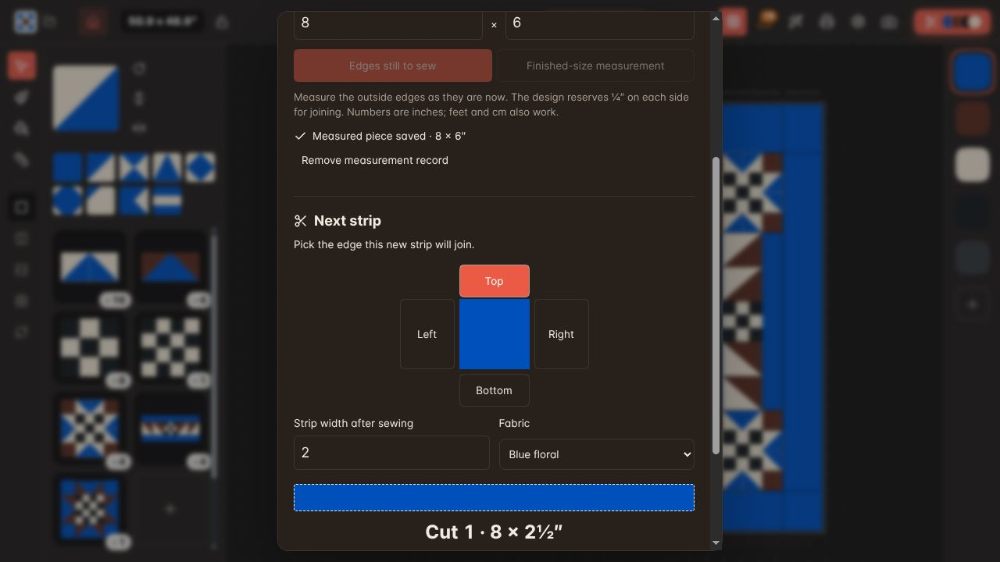

# Adaptive making and camera measurement

Implemented locally on `codex/adaptive-camera`, November 15, 2026. Not deployed.

The first complete flow is: set the intended quilt size → photograph a piece with a ruler → review its outline and dimensions → select its place in the quilt → record its actual size → calculate a strip for the next join. Camera processing and measurement records stay in the existing client-side application; no measurement API or image upload was added. Optional existing project sync can carry measurement numbers as part of the design.

## What is built

- The displayed quilt dimensions open a sizing sheet. `4 ft`, inches, mixed fractions, cm and mm are accepted. Proportions start linked; seam allowances stay fixed while geometry and derived cuts update. The quilt-size lock has a separate control.
- Camera capture requests the rear-facing camera and shows outline suggestions. A photo fallback and a clearly labeled illustrated example use the same calibration and measurement flow. Two ruler ticks establish overhead scale; four corners of a known rectangle establish a planar perspective correction. Points can be moved or reset, and opposing-edge differences are shown. Changing calibration requires reviewing the result again.
- Actual measurements have an explicit seam state. A measured root-level occurrence gets independent block definitions and is protected against later shape/size changes. Other unmade pieces in shared rows/columns adapt; conflicting measured pieces or locks produce a refusal. Undo/redo and persistence remain available.
- The next-strip helper uses the actual joining edge and adds the selected seam allowance to the strip's finished width. An 8-inch raw top edge and a 2-inch finished strip produce an 8 × 2½-inch cut at a ¼-inch seam allowance.
- The Svelte shell uses the sibling dawndishsoap app's keyboard/visual-viewport detection pattern and foreground/orientation recovery. Camera tracks stop on exit/backgrounding. Phone toolbars wrap so camera and making actions remain visible. QuiltStudio's existing offline worker is retained.

## Decisions

- [ADR 001: Preserve actual work while the plan adapts](decisions/001-adaptive-making.md)
- [ADR 002: Local camera measurement with a visible reference](decisions/002-calibrated-camera.md)
- [ADR 003: Svelte PWA with sibling iPhone shell patterns](decisions/003-iphone-pwa-shell.md)

## Filed issues

These are local Ishoo issues, with generated records under `.ishoo/records/issues/`. They are not GitHub issues. Implementation evidence is recorded against the integrated work; these entries do not claim a production release.

| Issue | Outcome | Current scope |
| --- | --- | --- |
| ISS-01 | Resize from the displayed quilt dimensions | Implemented and browser-checked |
| ISS-02 | Ruler-calibrated camera/photo measurements | Implemented; synthetic/browser checks pass; physical validation open |
| ISS-03 | Adapt the next uncut strip to an actual block | Root-level checkpoint and standalone strip helper implemented |
| ISS-04 | Port the iPhone shell patterns | Viewport/lifecycle changes implemented; installed-device checks open |
| ISS-05 | Verify real fabric measurement accuracy on iPhone | Open; no accuracy claim from synthetic tests |
| ISS-06 | Keep progress and exports coherent as construction changes | Open; full cut list is labeled as a design reference |
| ISS-07 | Bring sketches/AI reference images into the typed editor | Open |
| ISS-08 | Integrate sizing, measurement and adaptive making | Implemented locally and verified as described below |

## Verification

`npm test` covers length parsing, proportional resizing and derived cuts, locks, independent measured occurrences, conflicting physical work, ordinary-edit guards, seam-state strip calculations, viewport keyboard classification, ruler calibration, projective geometry, invalid references, unequal edges, and outline segmentation including a pale outside corner. There are 13 passing tests.

`npm run check` reports no errors. Ten existing unused-CSS warnings remain in ContextBar and Sizes. `npm run build` succeeds with the existing large-bundle advisory.

The local browser flow was checked at desktop and 390 × 844 dimensions:

1. Entered `4 ft`; preview and saved quilt became 48 × 48 inches.
2. Used the illustrated 8 × 6-inch block. The detector suggested all four outside corners; manually tapped 0 and 6 ruler marks yielded approximately 7.98 × 5.97 inches. This verifies the flow, not real-world precision.
3. Passed the estimate into the making sheet, corrected it to 8 × 6, saved it, and chose the top edge. The strip result was 8 × 2½ inches.
4. Confirmed Undo restores the prior quilt and Redo restores the checkpoint. Reloading retains the measurement.
5. Confirmed whole-quilt resizing is refused after a measured checkpoint, while merely opening the size sheet does not create a spurious rounded-size change.
6. Checked camera/making actions remain visible on the phone-width toolbar. Captured browser console contained no warnings or errors.

## Deliberate limits and next validation

Camera output is an estimate. Actual installed iPhone camera capture, permission denial, background/resume, image orientation, keyboard behavior and measurement error require device testing (ISS-05). The detector assumes flat fabric, clear margins and a contrasting surface. It is an editable suggestion; arbitrary backgrounds, folds and occlusion are not solved. A two-tick reference requires an overhead image. A four-corner reference corrects planar perspective, not lens distortion or fabric height.

Adaptive checkpoints currently identify top-level layout cells. This is not a general assembly constraint solver. The strip helper does not insert a strip into the drawn layout or reserve its fabric in the yardage total. Existing cut/sew checkmarks reset when dimensions change because they are not yet tied to individual physical pieces; the full design cut list still includes measured work and is labeled accordingly (ISS-06).

Next validation should compare repeated photographs of ruler-measured fabric rectangles on a real iPhone, including plain/patterned/pale fabric, camera tilt, and lighting changes. Record device/OS, actual dimensions, estimates, corner corrections, maximum edge error and setup time before deciding whether the camera is accurate enough to guide cutting.
